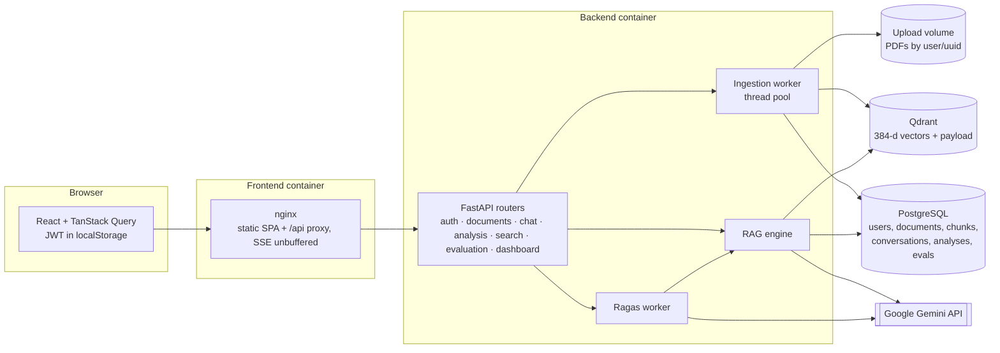
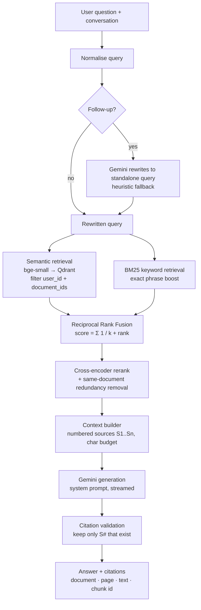
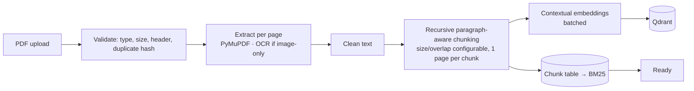

# LegalMind AI

**Intelligent legal research & contract intelligence platform** — upload contracts, policies and agreements,
ask questions in plain language, and get answers grounded in your documents with **document- and page-level
citations**. Built on an advanced hybrid RAG pipeline (semantic + BM25 → Reciprocal Rank Fusion → cross-encoder
reranking → Gemini → citation validation), with contract risk review, document comparison, structured
summaries and Ragas evaluation.

> LegalMind AI provides informational assistance and is not a substitute for professional legal advice.

---

## ⚡ Quick start (for whoever cloned this repo)

You need **one** of the two options below. Option A is the easiest.

### 0. Get the code and a Gemini key

```powershell
git clone <this-repo-url> C:\dev\legalmind-ai
cd C:\dev\legalmind-ai
copy .env.example .env
```

Open `.env` in Notepad and paste a free Gemini API key from <https://aistudio.google.com/apikey> after
`GEMINI_API_KEY=`. (No key? The app still runs: upload, indexing, search and evidence retrieval work, and AI
features tell you the key is missing.)

> **Windows tip:** clone into a short folder such as `C:\dev\legalmind-ai`. Windows limits file paths to 260
> characters and some Python packages have deep paths; a long folder path (for example deep inside
> `Documents\...\OneDrive\...`) can break the local (non-Docker) install.

### Option A — Docker (recommended, nothing else to install)

1. Install **Docker Desktop**: <https://www.docker.com/products/docker-desktop/> and start it.
2. In the project folder run:

```powershell
docker compose up --build
```

3. Open **<http://localhost:8080>**, create an account, and upload a PDF (try the ones in [`sample_data/`](sample_data/)).

First build takes ~5–10 minutes (it downloads PyTorch CPU and the models). Later starts take seconds.
API docs: <http://localhost:8000/docs>. Stop with `Ctrl+C`, or `docker compose down` (data is kept in Docker
volumes; `docker compose down -v` wipes it).

### Option B — Run locally without Docker (Windows)

Requires **Python 3.11 or 3.12** (<https://www.python.org/downloads/>, tick *Add python.exe to PATH*) and
**Node.js 20+** (<https://nodejs.org/>).

```powershell
powershell -ExecutionPolicy Bypass -File scripts\setup.ps1
```

```powershell
powershell -ExecutionPolicy Bypass -File scripts\start.ps1
```

`setup.ps1` (one time) creates `.env`, a Python virtualenv, installs CPU PyTorch + dependencies, installs the
frontend and downloads the two ML models. `start.ps1` opens two windows (backend + frontend) and the browser at
<http://localhost:5173>. Local mode needs **no database or vector server**: it uses SQLite and an embedded,
on-disk Qdrant automatically.

macOS / Linux: `./scripts/setup.sh` then `./scripts/start.sh`.

### Try it in 2 minutes

1. Upload both PDFs from [`sample_data/`](sample_data/) on **My Documents** (they are fictional contracts — a
   2025 Master Services Agreement and a 2026 renewal draft).
2. **AI Research Assistant** → *"What are the termination conditions?"* → click the `S1` markers to see the cited page.
3. **Contract Analysis** → *Analyse risks* / *Summary* (export to PDF).
4. **Document Comparison** → compare the 2025 agreement with the 2026 draft.
5. **RAG Evaluation** → *Load sample dataset* → *Run evaluation* (real Ragas scores on the sample data).

### Troubleshooting

| Problem | Fix |
| --- | --- |
| "Gemini API key is not configured" | Put `GEMINI_API_KEY=...` in `.env`, then restart (`docker compose up -d --force-recreate backend`, or close and re-run `start.ps1`). |
| "Gemini rate limit or quota exceeded" | Free tier limits; wait a minute. Ragas evaluation makes many calls — use small datasets. |
| Port 8080 / 8000 already in use (Docker) | Set `FRONTEND_PORT=8081` and/or `BACKEND_PORT=8001` in `.env`, then `docker compose up -d`. The app is then at `http://localhost:8081`. |
| `DLL load failed ... filename or extension is too long` | Move the project to a short path like `C:\dev\legalmind-ai` and re-run setup. |
| `running scripts is disabled on this system` | Use the exact commands above (they include `-ExecutionPolicy Bypass`). |
| Scanned PDF says "no extractable text" | OCR needs Tesseract. It is included in Docker; for local mode install Tesseract and restart. |
| First question is slow | The embedding and reranker models load on first use (`PRELOAD_MODELS=true` loads them at startup). |

---

## Problem statement

Legal teams spend hours locating clauses, comparing contract versions and checking obligations. Generic
chatbots hallucinate clauses and page numbers, which is unacceptable for legal work. LegalMind AI retrieves the
exact passages first, forces the model to cite them, and **validates every citation against the retrieved
chunks** — anything that cannot be traced back to a real page is removed.

## Features

| Area | What it does |
| --- | --- |
| **Auth & isolation** | Registration, login, JWT sessions, bcrypt hashing. Every query filters by `user_id` on the server (SQL *and* Qdrant payload filter, plus a defence-in-depth check). Other users' resources return 404. |
| **Ingestion** | Multi-file drag & drop with progress, validation (type, size, PDF header, corruption, encryption, empty), SHA-256 duplicate detection, background processing with live status, page-level extraction (PyMuPDF), cleaning, optional OCR, re-index and delete. |
| **Hybrid RAG** | Query normalisation + conversational query rewriting → semantic search (bge-small, Qdrant) + BM25 (exact `"phrase"` support) → Reciprocal Rank Fusion → cross-encoder reranking with redundancy removal → token-budgeted context with numbered sources. |
| **Grounded generation** | Gemini with the LegalMind system prompt, streamed over SSE. `[S#]` citations validated against retrieved chunks; invalid markers stripped. Without context the LLM is never called. |
| **Research assistant** | Multi-turn conversations, streaming, Markdown, citation chips, expandable evidence, page preview, copy, regenerate, suggested questions, document scoping, history. |
| **Contract risk** | 9 clause categories, per-finding clause name, verified quote, risk, explanation, LOW/MEDIUM/HIGH, document + page. Findings without valid evidence are discarded; unverifiable quotes are replaced with the real passage. PDF export. |
| **Comparison** | 9 aspects side by side, common / different / missing, wording changes, inconsistencies; each side may only cite its own document. |
| **Summaries** | Short / medium / detailed: executive summary, parties, obligations, financial terms, dates, termination, liability, confidentiality, risks — each item cited. PDF export. |
| **Advanced search** | Semantic / keyword / hybrid, document filters, top-K, rerank toggle, per-retriever ranks, relevance scores, history, open the exact page. |
| **Ragas evaluation** | Datasets & questions, sample dataset (clearly flagged), background runs, Faithfulness / Answer Relevancy / Context Precision / Context Recall, per-question inspection with retrieved context. Failed runs show the real reason; no score is ever invented. |
| **Dashboard** | Real stats only (documents, queries, conversations, latency, processing), activity charts, empty states for new accounts. |

## Technology stack

**Frontend:** React 18, TypeScript, Vite 6, Tailwind CSS 4, shadcn/ui-style components on Radix UI, Lucide,
React Router, TanStack Query, Recharts, React Hook Form + Zod, Sonner, react-markdown.
**Backend:** Python 3.11, FastAPI, Pydantic v2, SQLAlchemy 2, Alembic, Uvicorn.
**AI / RAG:** Google Gemini (`google-genai`), LangChain (text splitting, Ragas judge wrappers),
Sentence-Transformers `BAAI/bge-small-en-v1.5`, `cross-encoder/ms-marco-MiniLM-L-6-v2`, Qdrant, rank-bm25.
**Documents:** PyMuPDF (+ Tesseract OCR). **Data:** PostgreSQL (SQLite in local mode). **Eval/tests:** Ragas 0.4,
Pytest, Vitest + Testing Library. **Infra:** Docker, Docker Compose, nginx.

## System architecture



## RAG pipeline





## Project structure

```
legalmind-ai/
├── backend/
│   ├── app/
│   │   ├── api/            # FastAPI routers (auth, documents, chat, analysis, search, evaluation, dashboard)
│   │   ├── services/       # pdf_processor, chunker, embeddings, vector_store, bm25_index, hybrid (RRF),
│   │   │                   # reranker, query_processing, citations, rag_pipeline, llm, analysis,
│   │   │                   # evaluation (Ragas), ingestion, pdf_export
│   │   ├── config.py  database.py  models.py  schemas.py  security.py  deps.py  main.py
│   ├── alembic/            # migrations (applied automatically at startup)
│   ├── scripts/generate_sample_pdfs.py
│   ├── tests/              # pytest suite (mocked Gemini, deterministic embedder, in-memory Qdrant)
│   ├── Dockerfile  requirements.txt  requirements-dev.txt
├── frontend/
│   ├── src/api/            # centralised API client (JWT, uploads with progress, SSE streaming)
│   ├── src/components/     # layout shell, evidence UI, shadcn-style primitives
│   ├── src/pages/          # 10 pages
│   ├── src/test/           # vitest tests
│   ├── Dockerfile  nginx.conf
├── sample_data/            # fictional sample contracts for demos + the sample Ragas dataset
├── scripts/                # setup/start/test scripts (Windows .ps1, macOS/Linux .sh)
├── docker-compose.yml  .env.example
```

## Environment configuration

All settings live in `.env` (copy of [`.env.example`](.env.example)); every key is documented there. The most
important ones:

| Key | Default | Notes |
| --- | --- | --- |
| `GEMINI_API_KEY` | — | Required for AI answers, analysis, evaluation. Server-side only — never sent to the browser. |
| `GEMINI_MODEL` | `gemini-2.5-flash` | Any Gemini model available to your key. |
| `JWT_SECRET` | placeholder | Set a long random value (setup scripts generate one). |
| `DATABASE_URL` | SQLite file | Docker sets PostgreSQL automatically. |
| `QDRANT_URL` | empty → embedded | Docker sets `http://qdrant:6333`. |
| `CHUNK_SIZE` / `CHUNK_OVERLAP` | 1000 / 150 | Characters. Re-index documents after changing. |
| `RETRIEVAL_TOP_K` / `RERANK_TOP_N` / `RRF_K` | 20 / 6 / 60 | Candidate pool, final context size, RRF constant. |
| `MAX_UPLOAD_MB` | 25 | Per file (max 10 files per upload). |
| `RATE_LIMIT_PER_MINUTE` / `AI_RATE_LIMIT_PER_MINUTE` | 120 / 20 | Per user. |

## API

Interactive docs: <http://localhost:8000/docs> (Swagger) — all endpoints except register/login/health need
`Authorization: Bearer <token>`.

| Method | Endpoint | Purpose |
| --- | --- | --- |
| POST | `/api/auth/register`, `/api/auth/login` | Create account / sign in → JWT |
| GET | `/api/auth/me` | Current user |
| POST | `/api/documents/upload` | Multipart `files` (one or many PDFs) |
| GET | `/api/documents`, `/api/documents/{id}` | List / detail (with processing status) |
| DELETE | `/api/documents/{id}` | Delete file, chunks, vectors |
| POST | `/api/documents/{id}/reindex` | Re-run ingestion |
| GET | `/api/documents/{id}/file`, `/pages/{n}`, `/pages/{n}/image` | PDF, page text, rendered page |
| POST | `/api/chat/query` | `{question, conversation_id?, document_ids?, stream?, regenerate?}` — JSON or SSE |
| GET/DELETE | `/api/chat/conversations[/{id}]` | Conversation history |
| POST | `/api/analysis/summarize/{document_id}` | `{length: short\|medium\|detailed}` |
| POST | `/api/analysis/contract-risk/{document_id}` | Risk review |
| POST | `/api/analysis/compare` | `{document_a_id, document_b_id}` |
| GET | `/api/analysis`, `/api/analysis/{id}`, `/api/analysis/{id}/export.pdf` | Saved analyses, PDF export |
| POST | `/api/search` | `{query, mode: semantic\|keyword\|hybrid, document_ids?, top_k?, rerank?}` |
| GET/DELETE | `/api/search/history` | Search history |
| GET/POST | `/api/evaluation/datasets`, `/datasets/sample`, `/datasets/{id}/questions` | Dataset management |
| POST | `/api/evaluation/run` | `{dataset_id, document_ids?}` (runs in background) |
| GET | `/api/evaluation/results[/{id}]` | Runs with metrics and per-question details |
| GET | `/api/dashboard/stats`, `/api/dashboard/activity` | Real analytics |
| GET | `/api/health`, `/api/system/status` | Health and non-secret configuration |

Streaming (`stream: true`) emits Server-Sent Events: `meta` (conversation id, rewritten query, sources) →
`token`… → `final` (persisted message with validated citations).

## Testing

```powershell
powershell -ExecutionPolicy Bypass -File scripts\test.ps1
```

or separately: `cd backend; .\.venv\Scripts\python.exe -m pytest` and `cd frontend; npm test`.

* **Backend (pytest, 39 tests + 1 opt-in real-model test):** registration/login/JWT, PDF extraction & failure modes, chunking metadata,
  embeddings, Qdrant filtering, BM25 + phrases, RRF maths, reranking/redundancy, citation & quote validation,
  chat (non-streaming, SSE, follow-up rewriting, regenerate, no-key fallback, no-context), document permissions
  & cross-user isolation, rate limiting, risk analysis, comparison, summaries, PDF export, evaluation (mocked
  Ragas + real failure reason), dashboard. Gemini is mocked for deterministic tests; migrations run on a fresh DB.
* **Real models:** `RUN_MODEL_TESTS=1` additionally checks the real bge-small and cross-encoder rank correctly.
* **Frontend (vitest, 9 tests):** login validation & submit, dashboard real stats / empty / error states,
  document upload & client-side rejection, streamed chat with citations, search results & errors.

## Screenshots

Add your own screenshots to `docs/screenshots/` and reference them here, for example:

| Overview | Research assistant | Contract analysis |
| --- | --- | --- |
| `docs/screenshots/overview.png` | `docs/screenshots/assistant.png` | `docs/screenshots/risk.png` |

## Security notes

bcrypt password hashing · signed, expiring JWTs · server-side ownership checks on every resource (404, not 403,
to avoid leaking existence) · Qdrant queries always filtered by user · uploads stored as `<user-uuid>/<doc-uuid>.pdf`
(user file names are never used in paths; stored paths are re-validated against the storage root) · type, header
and size validation · per-user rate limits · restricted CORS · generic 500 responses (details only in logs) ·
Gemini key only on the server · `.env` git-ignored.

## Known limitations

* Answers are only as good as the retrieved passages; very long documents may need a larger `RETRIEVAL_TOP_K`.
* BM25 indexes are built in memory per user (rebuilt after document changes) — fine for thousands of chunks,
  not for millions.
* Ragas evaluation uses Gemini as the judge, so the free tier's rate limits make large datasets slow.
* OCR quality depends on scan quality; OCR is skipped in local mode unless Tesseract is installed.
* Rate limiting is in-memory (single backend instance).
* Token storage in `localStorage` is simple but less robust than httpOnly cookies against XSS.
* LegalMind AI does not give legal advice and does not decide whether a clause is enforceable.

## Future improvements

* Clause-level highlighting inside the rendered PDF page.
* Redis-backed job queue and rate limiting for multi-instance deployments.
* Per-workspace sharing with roles; SSO.
* Table-aware PDF parsing and section-hierarchy chunking.
* Hybrid search inside Qdrant (sparse vectors) to replace the in-memory BM25 index at scale.
* Automatic evaluation-question generation from uploaded documents.
